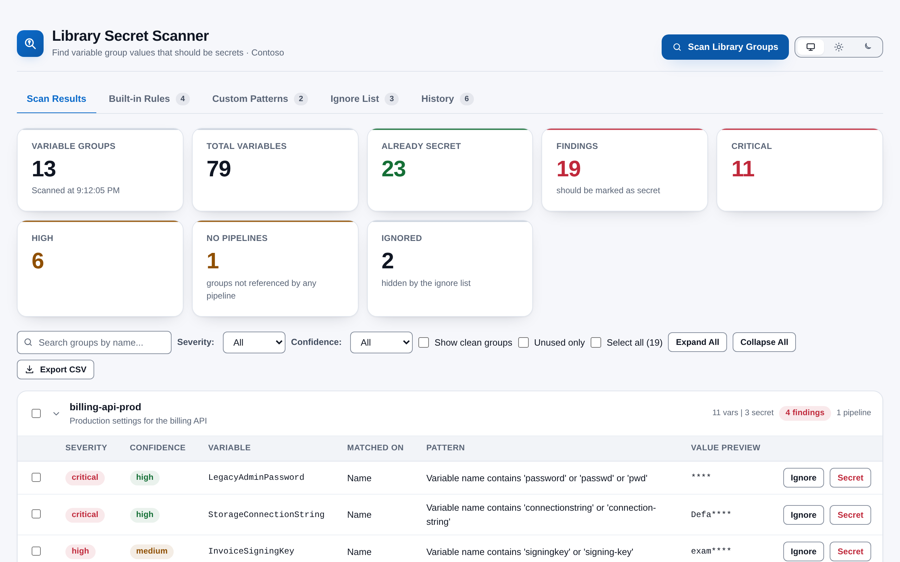
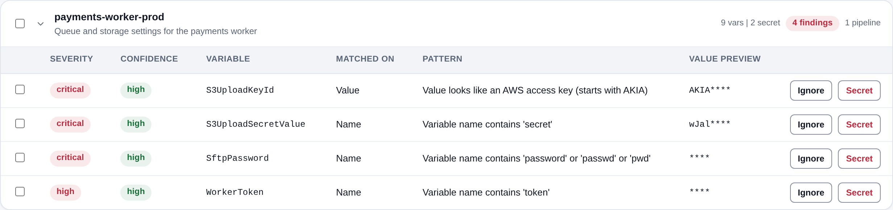
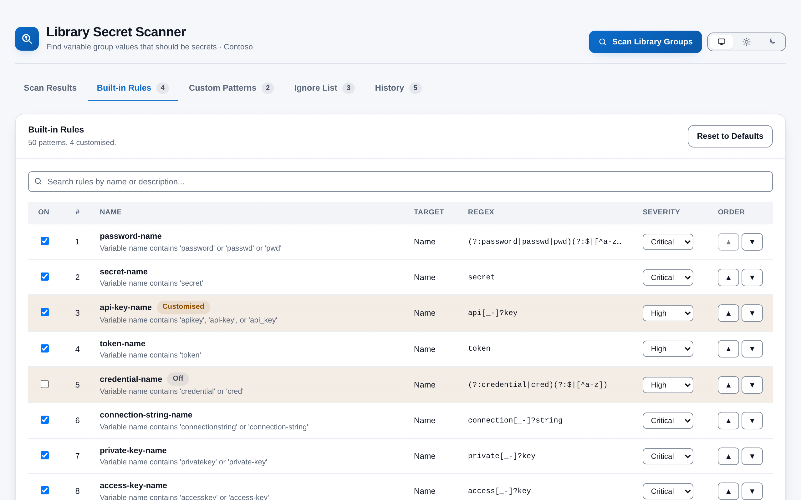
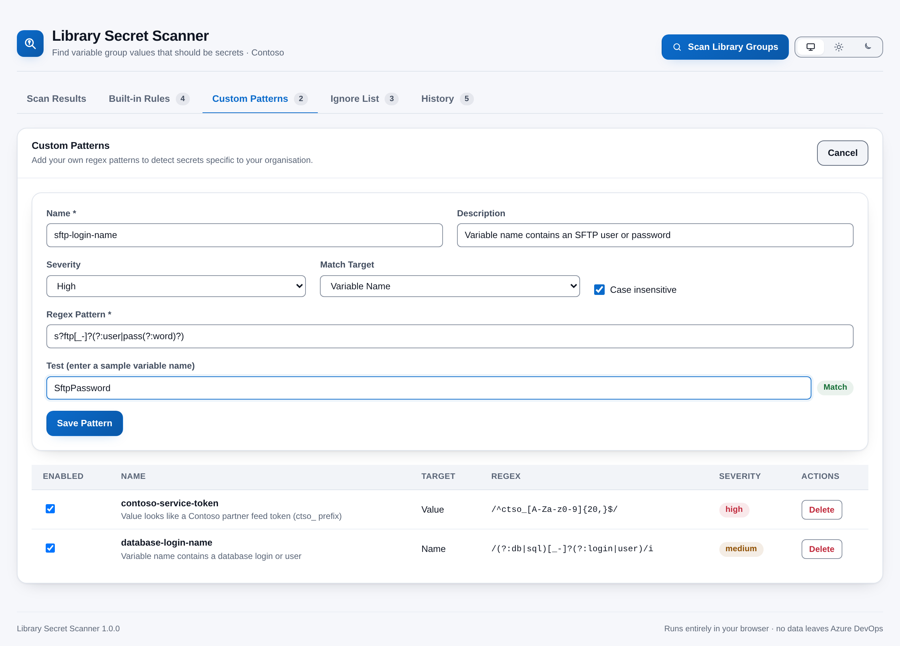
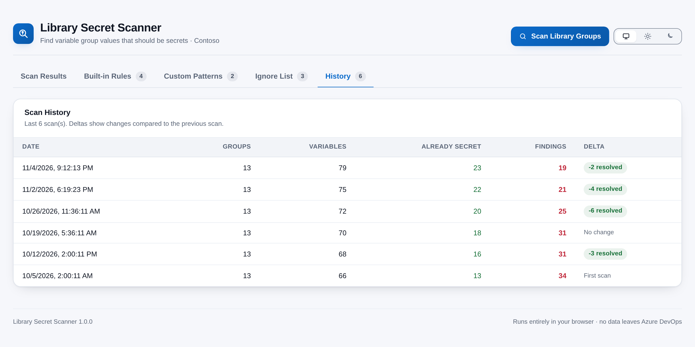

# Library Secret Scanner

[](https://github.com/adam-wheater/azure-devops-library-secret-scanner/actions/workflows/ci.yml)

An Azure DevOps extension that scans every **Library variable group** in a project and answers one question: *which variables hold a secret but are not marked as secret?* It matches built-in and custom regular expressions against variable **names** and **values**, ranks findings by severity and confidence, shows which YAML pipelines use each group, and lets you mark variables as secret or dismiss false positives in place. It is built for project administrators, security reviewers and platform teams. Everything runs in the browser against your organization's own Azure DevOps REST API, from a hub under **Pipelines > Secret Scanner**.



## Table of contents

- [Getting started](#getting-started)
- [Features](#features)
- [Screens](#screens)
  - [Header and tabs](#header-and-tabs)
  - [Scan Results tab](#scan-results-tab)
  - [Built-in Rules tab](#built-in-rules-tab)
  - [Custom Patterns tab](#custom-patterns-tab)
  - [Ignore List tab](#ignore-list-tab)
  - [History tab](#history-tab)
- [How it works](#how-it-works)
- [Settings](#settings)
- [Detection rules](#detection-rules)
  - [Variable name (25)](#variable-name-25)
  - [Variable value (25)](#variable-value-25)
  - [False-positive suppression](#false-positive-suppression)
  - [Confidence](#confidence)
- [Scopes & permissions](#scopes--permissions)
- [Privacy](#privacy)
- [Troubleshooting and known limitations](#troubleshooting-and-known-limitations)
- [Development](#development)
- [Project structure](#project-structure)
- [Tech stack](#tech-stack)
- [Contributing](#contributing)
- [License](#license)

## Getting started

1. Install **Library Secret Scanner** from the Visual Studio Marketplace (publisher `adam-wheater`): <https://marketplace.visualstudio.com/items?itemName=adam-wheater.library-secret-scanner>.
2. Open any project and go to **Pipelines**. The hub appears as **Secret Scanner** in the Pipelines hub group (`ms.vss-build-web.build-release-hub-group`, order 99).
3. **First run:** the four settings documents are created empty for your organization, and the Scan Results tab invites you to scan. Nothing is scanned automatically.
4. Click **Scan Library Groups**. Marking variables as secret needs permission to edit those variable groups.

## Features

- **Name and value detection** -- 50 built-in patterns (25 on variable names, 25 on values) cover passwords, keys, tokens, connection strings, certificates and well-known token formats.
- **Severity and confidence** -- Each finding has a severity (Critical, High, Medium, Low) and a confidence (High, Medium, Low) derived from pattern specificity, value entropy and the variable name.
- **False-positive suppression** -- GUIDs, Azure resource IDs and values of ID-style variables (`TenantId`, `ClientId`, ...) are not reported by the generic long-string patterns.
- **Mark as secret** -- Mark one variable or many across groups as secret from the results, after a confirmation; the project is rescanned afterwards.
- **Ignore list with expiry** -- Dismiss false positives singly or in bulk with an optional reason and expiry date, and restore them later.
- **Custom patterns** -- Add your own name or value regexes with severity and case sensitivity, tested inline before saving.
- **Built-in rule overrides** -- Turn any built-in pattern off or change its severity; reset to defaults at any time.
- **Pipeline usage** -- See which YAML pipelines reference each group and find groups no pipeline uses.
- **Key Vault awareness** -- Key Vault-linked groups are labelled and never modified.
- **Scan history** -- The last 10 scans with totals and the change in findings since the previous scan.
- **Masked value previews** -- A flagged value shows only its first four characters when it is 16 characters or more, and nothing but `****` when it is shorter, on screen and in the CSV export.
- **CSV export** -- Export the currently filtered findings with the same masked previews.
- **Theme follows Azure DevOps** -- Light, dark and high-contrast host themes are followed automatically, with a manual Azure DevOps / Light / Dark override.
- **WCAG AA contrast** -- Design-system colour pairs meet 4.5:1 for text and 3:1 for UI in both palettes; severity is always shown as text, not colour alone.

Scans cannot be cancelled once started (they are usually short; see [Known limitations](#troubleshooting-and-known-limitations)). Settings are stored organization-wide, not per project.

## Screens

### Header and tabs

The header is the shared `AppShell`: the brand mark, the product name, the tagline with the current project, the **Scan Library Groups** button and the theme toggle. Tab counts appear only when non-zero.

### Scan Results tab

Before the first scan the tab shows "Click **Scan Library Groups** to check for variables that should be marked as secret." Banners above the results report a scan failure, the pipeline-usage warning, a settings load failure (with **Retry**), and the outcome of mark-as-secret and bulk-ignore actions. A warn banner also lists up to five groups referenced by pipelines whose **names** suggest they hold secrets (containing `secret`, `credential`, `password`, `key-vault`/`keyvault`, `private`, `sensitive`, `crypto`, `auth` or `token`).

#### Summary metrics

| Metric | Definition | Tone / shown |
|---|---|---|
| Variable Groups | Groups in the project; hint "Scanned at *time*" | always |
| Total Variables | Sum of variables across groups, secret or not | always |
| Already Secret | Variables already marked secret | success (green), always |
| Findings | Findings after the ignore list; hint "should be marked as secret" or "all groups look clean" | danger (red) if > 0, else success |
| Critical / High | Findings of that severity | danger / warn, only when > 0 |
| No Pipelines | Groups no YAML pipeline references | warn, only when > 0 |
| Ignored | Findings hidden by the ignore list in this scan | only when > 0 |

A variable can produce more than one finding (for example a name match and a value match), so Findings counts findings, not variables.

#### Toolbar

- **Search groups by name** (substring, case-insensitive), **Severity** and **Confidence** filters, **Show clean groups** (off by default) and **Unused only** (groups with no pipeline references). Changing any filter returns to page 1. None of these are saved.
- **Select all (*n*)** selects every visible finding outside Key Vault groups (indeterminate when some are selected); **Expand All** / **Collapse All**.
- With a selection: **Ignore Selected (*n*)** and **Mark as Secret (*n*)**.
- **Export CSV** (when there are findings) downloads `secret-scan-YYYY-MM-DD.csv` of the **currently filtered** findings with columns Variable Group, Group ID, Variable Name, Severity, Confidence, Matched On, Pattern, Description, Value Preview.

Groups are paged 100 per page with **Prev** / **Next** and "Page *x* of *y* (*n* groups)". Empty states: "No issues found -- all variable groups look clean!" or "No groups match the current filter."

#### Group cards



Each card header is a keyboard-operable disclosure (Enter or Space) showing a group checkbox (not for Key Vault groups), the name and description, "*n* vars | *m* secret", and pills: **Clean** (green) or "*n* findings" in the tone of the worst severity, **Key Vault** (accent) for Key Vault-linked groups, and **No Pipelines** (amber) or "*n* pipelines" with the pipeline and repository names in the tooltip.

| Column | Definition |
|---|---|
| Select | Checkbox for bulk actions |
| Severity | Pill: critical and high are danger (red), medium is warn (amber), low is info (blue); the severity is written in the pill |
| Confidence | Pill: high success (green), medium warn (amber), low neutral |
| Variable | Variable name |
| Matched On | Name or Value |
| Pattern | The pattern's description |
| Value Preview | The first 4 characters then `****` for values of 16 characters or more; shorter values show only `****` |
| Actions | **Ignore** and **Secret** (Secret is absent for Key Vault groups) |

Clicking elsewhere in a row opens the group in the Azure DevOps Library in a new window.

#### Confirmations

| Action | Dialog |
|---|---|
| Ignore | "Ignore Finding": optional **Reason** and optional **Expiry date** (today or later; the ignore lasts until the end of that local day); Enter confirms |
| Ignore Selected | "Ignore Selected Findings": same fields, applied to every selected finding |
| Secret | "Mark as Secret" (red): "Mark variable "*name*" in group "*group*" as secret? This cannot be undone." |
| Mark as Secret (bulk) | "Mark *n* variable(s) across *m* group(s) as secret? This cannot be undone." Key Vault groups are excluded |

Marking reads the group, sets `isSecret` on the named variables and writes the group back with `updateVariableGroup`; variables no longer present are reported as not found. After any mark the whole project is rescanned. Key Vault groups are refused with "Key Vault-linked variable groups are read-only and cannot be modified here."

### Built-in Rules tab



A table of all 50 built-in patterns with a search box (name or description). Hint: "50 patterns. *n* customised." or "All using defaults."

| Column | Meaning |
|---|---|
| On | Enable or disable the pattern |
| # | Position in the list |
| Name / description | Pattern id and description; **Off** (neutral) or **Customised** (amber) pill; customised rows are tinted amber |
| Target | Name or Value |
| Regex | The pattern source |
| Severity | Critical / High / Medium / Low override |
| Order | ▲ / ▼ to move; disabled while a search is active ("Clear the search to reorder rules.") |

**Save Changes** appears once something changes. **Reset to Defaults** appears when overrides exist and saves an empty override list immediately, without confirmation. Only modified patterns are stored.

### Custom Patterns tab



**Add Pattern** opens a form: **Name** (required, unique), **Description** (defaults to the name), **Severity** (default High), **Match Target** (Variable Name or Variable Value), **Case insensitive** (on by default), **Regex Pattern** (required; an invalid regex shows its error and blocks saving) and a **Test** box that shows **Match** or **No match** against a sample. The list shows Enabled (toggle), Name with an **Off** pill when disabled, Target, `/regex/flags`, a severity pill and **Delete**. Delete takes effect immediately. Patterns cannot be edited after saving; delete and re-add instead. Empty state: "No custom patterns defined yet."

### Ignore List tab

Entries newest first, searchable by group, variable, pattern or reason.

| Column | Meaning |
|---|---|
| Variable Group / Variable / Pattern | What is ignored |
| Reason | The optional reason, or a dash when none was given |
| Ignored At | Date |
| Expires | Date, "Never", or "Expired *date*" in the error colour; expired rows are dimmed and no longer hide anything |
| Restore | Removes the entry; the finding returns on the next scan |

**Clear All** asks "Clear all *n* entries? Every ignored finding will show up again on the next scan." Entries are keyed by variable group id, variable name and pattern name.

### History tab



The last 10 scans, newest first: Date, Groups, Variables, Already Secret (green), Findings (red when > 0, else green), and Delta, which shows "First scan", a red **+*n* new** pill, a green **-*n* resolved** pill or "No change". The delta compares only the total number of findings with the previous entry.

## How it works

```
 SDK.init/ready ──> ThemeProvider ──> App
        │
        ├─ useScannerSettings ──> Extension Data Service, collection "SecretScannerSettings"
        │                         custom-patterns · ignore-list · builtin-pattern-overrides · scan-history
        │
        └─ [Scan Library Groups]
              1 IProjectPageService.getProject  ·  ILocationService.getServiceLocation
              2 TaskAgentRestClient.getVariableGroups(project)
              3 for each group, in memory:
                   built-in patterns (after overrides) + custom patterns
                   ──> false-positive filter ──> de-duplicate ──> ignore list ──> sort
              4 BuildRestClient.getDefinitions (continuation-token drained)
                   ──> getDefinition ×5 at a time ──> YAML pipelines only
                   ──> GitRestClient.getItemText(yaml) ×5 at a time ──> group names
              5 render results ──> append scan-history entry (keep 10)
```

1. **SDK init.** `SecretScanner.tsx` awaits `SDK.init()` and `SDK.ready()`, imports `styles/app.css` and renders `<ThemeProvider><App/></ThemeProvider>`. If the handshake fails, a plain-text message and the error are written into `#root`.
2. **Settings.** `useScannerSettings` loads four documents in parallel from the Extension Data Service collection `SecretScannerSettings` at the default (organization) scope. A document that does not exist is created empty; any other read failure is surfaced as "Failed to load settings" with **Retry** and nothing is overwritten. The scan button reads "Loading..." until this finishes.
3. **Project.** `IProjectPageService.getProject()` supplies the project name for the header and the scan; `ILocationService.getServiceLocation()` supplies the organization URL for Library links.
4. **Variable groups.** One `TaskAgentRestClient.getVariableGroups(project)` call returns every group with its variables. Variables already marked secret are skipped (their values are not returned).
5. **Matching.** For each group, every non-secret variable is tested against the enabled built-in name and value patterns (with severity overrides applied) and the enabled custom patterns. Value patterns only run on non-empty values. Generic matches that look like GUIDs or IDs are dropped (see [Detection rules](#detection-rules)). Findings are de-duplicated per variable, pattern name and match source, active ignore entries are removed, and the rest are sorted by severity then variable name.
6. **Pipeline usage.** `BuildRestClient.getDefinitions` is called until no continuation token is returned. Each definition is then read with `getDefinition`, five at a time; those with a `yamlFilename` and a repository are YAML pipelines. Their YAML file is read with `GitRestClient.getItemText(repoId, path, project)`, five at a time, and group names are extracted from `- group:` entries and legacy `variableGroups:` lists. A failure in this phase does not fail the scan; a warning banner says usage data may be incomplete.
7. **Result.** Groups with findings come first, ordered by finding count; groups with findings are expanded. A history entry (totals plus finding counts per group) is appended to `scan-history`, keeping the latest 10. If saving history fails it is only logged to the console.
8. **Progress and concurrency.** A progress bar shows "Fetching variable groups...", "Scanning "*group*"...", "Fetching pipeline definitions...", "Fetching pipeline details...", "Scanning pipeline YAML files..." with counts. Matching runs in memory; only the pipeline phase issues parallel requests (batches of five). A second scan cannot start while one runs, and there is no cancel.

## Settings

There is no separate settings screen; the tabs above edit these documents.

| Setting | Default | Validation | Effect |
|---|---|---|---|
| Built-in overrides | none | Per pattern: on/off, severity, order | Disabled patterns never run; severity overrides change the reported severity |
| Custom patterns | none | Name required and unique; regex must compile with the chosen flags | Added to the built-in patterns on the next scan |
| Ignore entries | none | Reason optional; expiry today or later | Matching findings are hidden while active |
| Scan history | empty | Capped at 10 entries | History tab |
| Theme | Follow Azure DevOps | Light or Dark override | Palette; ignored while high contrast is active |

**Storage:** the first four are documents `builtin-pattern-overrides`, `custom-patterns`, `ignore-list` and `scan-history` in the Extension Data Service collection `SecretScannerSettings` at the default scope, so they are shared by every user and every project in the organization. The theme choice is kept in the browser's `localStorage` under `library-secret-scanner.theme`.

## Detection rules

Name patterns are case-insensitive. Every rule can be disabled or re-graded in **Built-in Rules**.

### Variable name (25)

| Pattern | Trigger (name contains) | Severity |
|---|---|---|
| `password-name` | `password`, `passwd` or `pwd` not followed by a letter | Critical |
| `secret-name` | `secret` | Critical |
| `api-key-name` | `apikey`, `api-key`, `api_key` | Critical |
| `connection-string-name` | `connectionstring`, `connection-string`, `connection_string` | Critical |
| `private-key-name` | `privatekey`, `private-key`, `private_key` | Critical |
| `access-key-name` | `accesskey`, `access-key`, `access_key` | Critical |
| `subscription-key-name` | `subscriptionkey`, `subscription-key`, `subscription_key` | Critical |
| `kek-name` | `KEK` as a separate word, or `keyencryptionkey` (with optional `-`/`_`) | Critical |
| `master-key-name` | `masterkey`, `master-key`, `master_key` | Critical |
| `app-secret-name` | `appsecret`, `clientsecret` (with optional `-`/`_`) | Critical |
| `account-key-name` | `accountkey`, `account-key`, `account_key` | Critical |
| `storage-key-name` | `storagekey`, `storage-key`, `storage_key` | Critical |
| `token-name` | `token` | High |
| `credential-name` | `credential` or `cred` not followed by a letter | High |
| `signing-key-name` | `signingkey` (with optional `-`/`_`) | High |
| `encryption-key-name` | `encryptionkey` (with optional `-`/`_`) | High |
| `shared-key-name` | `sharedkey` (with optional `-`/`_`) | High |
| `primary-key-name` | `primarykey` (with optional `-`/`_`) | High |
| `secondary-key-name` | `secondarykey` (with optional `-`/`_`) | High |
| `subscription-id-name` | `subscriptionid` (with optional `-`/`_`) | Medium |
| `instrumentation-key-name` | `instrumentationkey` (with optional `-`/`_`) | Medium |
| `tenant-id-name` | `tenantid` (with optional `-`/`_`) | Medium |
| `thumbprint-name` | `thumbprint` or `fingerprint` | Medium |
| `certificate-name` | `certificate` or `cert` not followed by a letter | Medium |
| `client-id-name` | `clientid` (with optional `-`/`_`) | Low |

### Variable value (25)

| Pattern | Trigger | Severity |
|---|---|---|
| `connection-string-value` | contains `Server=`, `Data Source=`, `Initial Catalog=`, `User ID=`, `Password=` or `Integrated Security=` (case-insensitive) | Critical |
| `azure-storage-key` | whole value is 86 to 88 base64 characters ending in `=` or `==` | Critical |
| `sas-token` | contains `sv=YYYY-MM-DD…&sig=` or `SharedAccessSignature sr=` | Critical |
| `private-key-block` | contains `-----BEGIN [RSA /EC /DSA ]PRIVATE KEY-----` | Critical |
| `basic-auth-url` | contains `http(s)://user:pass@host` | Critical |
| `aws-key-pattern` | `AKIA` + 16 uppercase letters/digits | Critical |
| `github-token` | `ghp_`, `gho_`, `ghs_`, `ghr_` or `github_pat_` + 36 to 255 word characters | Critical |
| `azure-devops-pat` | 52 to 256 characters of lowercase `a-z` and `2-7` | Critical |
| `npm-token` | `npm_` + 36 or more alphanumerics | Critical |
| `sendgrid-key` | `SG.` + 22 + `.` + 43 URL-safe characters | Critical |
| `sendgrid-api-key` | starts with `SG.` + 20 or more URL-safe characters | Critical |
| `twilio-key` | `SK` + 32 hex characters (either case) | Critical |
| `twilio-api-key` | `SK` + 32 lowercase hex characters | Critical |
| `google-cloud-api-key` | `AIza` + 35 characters | Critical |
| `stripe-secret-key` | `sk_live_`, `pk_live_` or `rk_live_` + 24 or more alphanumerics | Critical |
| `hashicorp-vault-token` | `hvs.` + 24 or more characters | Critical |
| `slack-session-token` | `xoxs-` + 40 or more characters | Critical |
| `jwt-token` | three base64url segments starting `eyJ…eyJ…` | High |
| `guid-secret-pattern` | whole value is 30 or more of `A-Z a-z 0-9 ~ . _ -` | High |
| `bearer-token` | `Bearer ` followed by a token | High |
| `slack-token` | `xoxb-`, `xoxp-`, `xoxr-`, `xoxa-` or `xoxs-` + characters | High |
| `slack-bot-token` | `xoxb-` in the bot-token number format | High |
| `slack-user-token` | `xoxp-` in the user-token number format | High |
| `slack-webhook` | contains `https://hooks.slack.com/services/T…/B…/…` | High |
| `hex-key-value` | whole value is 40 or more hex characters | Medium |

### False-positive suppression

Only `guid-secret-pattern` and `hex-key-value` are filtered. A match is dropped when the value is a GUID, an Azure resource ID (`/subscriptions/…/`), or the variable name contains `subscriptionid`, `tenantid`, `clientid`, `resourcegroup`, `objectid`, `principalid`, `directoryid`, `workspaceid`, `appid`, `applicationid`, `projectid` or `correlationid` (with optional `-`/`_`). `guid-secret-pattern` matches shorter than 34 characters are also dropped. Not configurable.

### Confidence

| Confidence | Rule |
|---|---|
| High | A high-specificity value pattern (every value pattern except `guid-secret-pattern`, `hex-key-value`, `bearer-token`, `azure-devops-pat` and `slack-token`); or a name match whose name contains `password`, `secret`, `privatekey`, `accesskey`, `apikey`, `token`, `connectionstring` or `credential`; or another value match with Shannon entropy ≥ 4.0 and such a name |
| Medium | Any other name match; or a value match with entropy ≥ 4.0 or such a name, but not both |
| Low | Any other value match |

Custom patterns use the same confidence rules; their severity is whatever you set.

## Scopes & permissions

| Scope | Concrete calls |
|-------|----------------|
| `vso.variablegroups_read` | `TaskAgentRestClient.getVariableGroups`, `getVariableGroup` |
| `vso.variablegroups_manage` | `TaskAgentRestClient.updateVariableGroup` (mark as secret) |
| `vso.project` | No REST call depends on it. The project comes from the host's `IProjectPageService` and the organization URL from `ILocationService`; it is still requested. |
| `vso.build` | `BuildRestClient.getDefinitions`, `getDefinition` (pipeline usage) |
| `vso.code` | `GitRestClient.getItemText` (read pipeline YAML) |

The Extension Data Service is called with the token from `SDK.getAccessToken()`; no `vso.extension.data` scope is declared.

## Privacy

Everything runs in the browser inside the Azure DevOps web UI and calls only your organization's Azure DevOps REST API. There is no telemetry and no third-party call. Variable values are read into the page to be matched and are never stored. The extension stores:

| What | Where |
|---|---|
| Custom patterns, built-in overrides | Extension Data Service, collection `SecretScannerSettings`, organization scope |
| Ignore entries (group id and name, variable name, pattern, reason, dates) | same collection, `ignore-list` |
| Scan history (totals and finding counts per group name, last 10 scans) | same collection, `scan-history` |
| Theme choice | Browser `localStorage`, `library-secret-scanner.theme` |

The CSV export is written by your browser to your own machine. It contains masked previews (see limitations).

## Troubleshooting and known limitations

| Symptom / limitation | Explanation |
|---|---|
| "Failed to load settings" and **Retry** does not help | The data manager is created once per page and a failed creation (for example no access token) is kept, so Retry repeats the same failure. Reload the page. |
| Settings and history look the same in every project | All documents are stored at organization scope. Project-scoped settings exist in `ScannerSettingsService` but are not used by the UI. History therefore mixes scans from different projects. |
| No way to stop a scan | There is no cancel. The button is disabled until the scan and pipeline lookup finish. |
| Very large projects | Variable groups are fetched with one `getVariableGroups` call without paging parameters; whether the service caps very large result sets was not verified. Pipeline usage reads every definition individually, five at a time. |
| "No Pipelines" on a group that is used | Only YAML pipelines are checked, by reading the YAML file from the repository's default branch. Templates and `extends` are not followed, group names set through variables are taken literally, classic release pipelines are not inspected, and files that cannot be read (for example non-Azure Repos repositories) are skipped silently. Groups are matched by name. |
| Two findings for one value | Some value patterns overlap: `twilio-key`/`twilio-api-key`, `sendgrid-key`/`sendgrid-api-key`, `slack-token` with `slack-bot-token`/`slack-user-token`, and `guid-secret-pattern` with most long tokens. Disable the duplicates in Built-in Rules if you prefer one finding. |
| Generic false positives | `guid-secret-pattern` matches any 34+ character run of letters, digits and `~._-`, such as long dotted identifiers. Ignore them or disable the rule. |
| Reordering built-in rules changes nothing | All enabled patterns always run and results are sorted by severity; the order is stored but has no effect on findings. |
| The value preview reveals part of a secret | Values of 16 characters or more show their first 4 characters, on screen and in the CSV export. Shorter values show only `****`. |
| Clicking a finding row does nothing | Rows open the Library with `window.open`, which the extension iframe sandbox can block. |
| Marking as secret cannot be undone | Azure DevOps does not return secret values. The group is read and written back whole, so a concurrent edit to the same group between the read and the write is overwritten. |
| An ignored finding came back | Ignore entries match the group id, variable name and pattern name exactly; renaming the variable, or an expired entry, makes the finding reappear. |
| History delta looks wrong | The delta is the difference in total findings only, not which findings changed. |
| Custom pattern cannot be edited, or delete was instant | Only enable/disable and delete are offered; delete and Reset to Defaults have no confirmation. A custom pattern with the same name as a built-in pattern is merged with it by de-duplication. |
| Page becomes unresponsive with a custom pattern | Custom regexes run against every variable; a pattern with catastrophic backtracking can stall the tab. |
| High contrast detected (or not) incorrectly | Detection is a heuristic on host text colours plus `forced-colors`; the theme toggle is hidden in high contrast on purpose. |

## Development

### Prerequisites

- Node.js 20 or later (`engines.node >= 20`)
- npm; install with `npm ci --legacy-peer-deps` (or `npm install --legacy-peer-deps`)

### npm scripts

| Script | What it does |
|--------|--------------|
| `npm run build` | Production webpack build into `dist/`; `postbuild` runs `scripts/verify-bundle.js`, then `scripts/third-party-notices.js`. |
| `npm run build:dev` | Development build with source maps |
| `npm run screenshots` | Builds the hub on sample data and saves the screenshots to `static/screenshots/` (see below). |
| `npm run verify:bundle` | Run the `dist/` check on its own |
| `npm run package` | `tfx extension create` -> `out/*.vsix` |
| `npm test` | Jest, both projects, verbose |
| `npm run test:watch` | Jest in watch mode |
| `npm run lint` / `npm run lint:fix` | ESLint 9 over `src/` and `tests/` |
| `npm run format` / `npm run format:check` | Prettier write / check over `src/` (including CSS) and `tests/` |
| `npm run publish:marketplace` | `tfx extension publish` with the manifest |

### Run it locally with sample data

`demo/` builds the real hub against stand-ins for the Azure DevOps SDK and REST clients, filled with a fictional "Contoso" project: thirteen variable groups, five YAML pipelines and a few saved settings. Every value that looks like a secret is a documented fake. Use it to try the UI without an organisation, and to refresh the screenshots:

```sh
npm i --no-save playwright && npx playwright install chromium   # once
npm run screenshots
```

After that, open `demo/dist/SecretScanner/SecretScanner.html` in a browser to click around. `demo/api.ts` holds the sample data and `demo/shots.json` lists the screenshots; the other files in `demo/` are the same in every extension. Nothing in `demo/` ships in the package.

### Release build (`build.ps1`)

`build.ps1` is the same script in every repository of this extension family. It runs the CI checks locally in the same order, then versions, builds and packages:

1. `npm ci --legacy-peer-deps` (the same install as CI)
2. `npm run lint`
3. `npm run format:check`
4. `npm test`
5. Bump the version in `vss-extension.json`, `package.json` and `package-lock.json`
6. `npm run build` (which also runs the bundle verification and writes the third-party notices)
7. `npm run package`, then check that `out/<publisher>.<id>-<version>.vsix` exists under exactly that name

The three manifests are snapshotted first. If any step after the bump fails, they are restored, so a failed build never leaves the version incremented.

| Parameter | Effect |
|-----------|--------|
| *(none)* | Bump the patch version (for example 1.0.0 to 1.0.1) and run every step |
| `-Version 1.1.0` | Release exactly that version (must be `x.y.z` and differ from the current one) |
| `-NoBump` | Repackage the current version unchanged (cannot be combined with `-Version`) |
| `-SkipInstall` | Reuse the existing `node_modules` |
| `-SkipTests` | Skip step 4 |
| `-SkipChecks` | Skip lint and format check (CI still enforces both) |

The repository is at version 1.0.0. Running `.\build.ps1` without `-NoBump` changes that, so commit the three manifest files together after a release.

### Tests

Jest runs two projects defined in `jest.config.js`: **unit** (Node, everything under `tests/` except `tests/components/`) and **components** (jsdom + Testing Library, `tests/components/`). The SDK, REST clients and CSS imports are mapped to `tests/__mocks__/`.

| Suite | Covers |
|---|---|
| `scanning/SecretPatternMatcher` | Name and value patterns (positive and negative cases, including the additional Google, Stripe, Vault, Slack, SendGrid and Twilio formats), already-secret and empty values, de-duplication, custom pattern compilation and matching, ignore filtering and expiry, false-positive suppression, entropy and confidence |
| `scanning/LibraryGroupService` | Variable extraction, group metadata (including Key Vault type), and draining the definitions continuation token |
| `services/ScannerSettingsService` | Seeding only on a genuine not-found, not-found detection, custom pattern add/update/remove with regex and duplicate validation, ignore list add/bulk add/remove/clear |
| `repo/npmScripts` | Fails if any npm script single-quotes an argument (`cmd.exe` on Windows does not strip single quotes), if a script that `build.ps1` or CI calls is missing, if `build.ps1` and `ci.yml` stop installing the same way (`npm ci --legacy-peer-deps`), or if `build.ps1` contains non-ASCII characters or a backtick followed by trailing whitespace (both break Windows PowerShell 5.1) |
| `repo/packageContents` | Fails if any path the manifest packages (other than `dist/`) contains an `.svg` file, which the Marketplace rejects, if a manifest icon is not an existing PNG, or if `icons.default` is not a 128x128 PNG |
| Components | `App` (heading, scan button, tabs, empty state), `ConfirmDialog` (input, expiry at end of local day, Enter/Escape), `FindingRow` (masking, actions), `GroupCard` (badges, expand, Key Vault), `ScanHistoryPanel` (first scan, deltas), `ScanToolbar` (filters, bulk actions, export) |

YAML group extraction, built-in overrides and scan-history persistence have no dedicated tests.

### Bundle verification

`scripts/verify-bundle.js` (the same script as in the rest of the family) reads the hub name from `webpack.config.js` and fails if, in `dist/SecretScanner/`: the page is missing or references an asset that was not emitted; no stylesheet was emitted or one is not linked; `SecretScanner.js` is not loaded; `#root` lacks `class="ax-root"`; the inline `<style>` pads `#root`; a lazy chunk named in the webpack runtime is missing; an AMD `define(` survived; or a `.d.ts` file landed in `dist/`.

### Design system and theming

- `src/styles/app.css` -- the `--ax-*` tokens and component classes. The dark palette is declared under `prefers-color-scheme: dark` guarded by `:root:not([data-theme="light"])` and again under `:root[data-theme="dark"]`; `:root[data-contrast="high"]` rebuilds the palette from host variables.
- `src/components/ui.tsx` -- shared primitives: `AppShell`, `ThemeToggle`, `Tabs`, `Button`, `Card`, `Pill`, `Metric`, `Banner`, `Progress`, `Skeleton`, `EmptyState`, `Gate`, `Modal`, `ConfirmDialog`, `Disclosure`, `SortHeader`, `ErrorBoundary` and icons. This product's own `components/ConfirmDialog.tsx` builds on `Modal` to add the reason and expiry fields.
- `src/brand.tsx` -- `BRAND` and the magnifier `BrandGlyph`, drawn to match the Marketplace and hub icon `static/icon.png` (a 128x128 PNG; the repository holds no SVG copy because the Marketplace rejects SVG files in packages).

`azure-devops-extension-sdk` writes the host theme as CSS variables on `:root` and dispatches a `themeApplied` event on init and on every change. `ThemeProvider` (`src/utils/theme.ts`) follows that event, plus `prefers-color-scheme`, `forced-colors` and a body-class observer, and stamps `data-theme="light|dark"` and `data-contrast="high"` on `<html>`. High contrast always wins, then the stored choice, then the host theme. High contrast is detected heuristically (pure black/white primary and secondary text, or `forced-colors: active`), and the theme toggle is hidden while it is active. `SecretScanner.html` re-applies the stored choice before the bundle loads.

### Accessibility checks applied

- Colour pairs audited for WCAG AA in both palettes; control borders use a token that clears 3:1.
- Severity, confidence and status are always written in their pills; critical and high share a colour and differ by text.
- Group headers are `role="button"` with `aria-expanded` and Enter/Space handling; checkboxes, filters and row actions have accessible names; indeterminate states are set on group and select-all checkboxes.
- Tabs use `role="tablist"`/`role="tab"`/`aria-selected`; the theme toggle uses `aria-pressed`; banners use `role="alert"`/`role="status"`; regex errors are announced with `role="alert"` and `aria-invalid`.
- `Modal` traps focus, closes on Escape and restores focus; the reason field takes initial focus in ignore dialogs.
- `prefers-reduced-motion` and `forced-colors` are respected; failure text outside React is written with `textContent`.

### Continuous integration

`.github/workflows/ci.yml` runs on pushes and pull requests to `main` (and `master`): `npm ci --legacy-peer-deps`, lint, format check, tests, build, bundle verification and packaging on Node 20, then uploads `out/*.vsix` as the `vsix-package` artifact.

## Project structure

```
src/
├── SecretScanner/
│   ├── SecretScanner.html          # Host page: links .css/.js, pre-stamps the stored theme
│   └── SecretScanner.tsx           # Entry point: SDK init/ready, ThemeProvider, App, SDK-failure fallback
├── brand.tsx                       # BRAND name/tagline and the magnifier BrandGlyph
├── components/
│   ├── App.tsx                     # Scan orchestration, mark/ignore actions, filters, paging, CSV, layout
│   ├── BuiltInPatternsPanel.tsx    # Built-in Rules tab: enable, severity, order, reset
│   ├── ConfirmDialog.tsx           # Confirm/prompt dialog with reason and expiry date
│   ├── CustomPatternPanel.tsx      # Custom Patterns tab: form, inline test, list
│   ├── FindingRow.tsx              # One finding row with masked preview (`maskValue`, shared with the CSV export) and actions
│   ├── GroupCard.tsx               # Variable group disclosure with badges and findings table
│   ├── IgnoreListPanel.tsx         # Ignore List tab: search, restore, clear all
│   ├── NotificationBanners.tsx     # Scan, pipeline, settings and mark-as-secret banners
│   ├── ScanHistoryPanel.tsx        # History tab
│   ├── ScanToolbar.tsx             # Search, filters, selection, bulk actions, export
│   ├── SettingsToolbar.tsx         # Tab strip with counts
│   ├── SummaryBar.tsx              # Summary metric tiles
│   └── ui.tsx                      # Shared design-system primitives and icons
├── hooks/
│   └── useScannerSettings.ts       # Loads and mutates the four settings documents
├── models/
│   └── interfaces.ts               # Types and enums (Severity, MatchSource, Confidence, documents)
├── scanning/
│   ├── LibraryGroupService.ts      # Variable groups, mark as secret, pipeline YAML usage
│   └── SecretPatternMatcher.ts     # Matching, confidence, de-duplication, ignore filter, overrides
├── services/
│   └── ScannerSettingsService.ts   # Extension Data Service persistence
├── styles/
│   └── app.css                     # Design system tokens (--ax-*) and component styles
└── utils/
    ├── constants.ts                # Built-in patterns, tones, collection/doc ids, false-positive rules
    ├── formatError.ts              # Readable messages from SDK error objects
    ├── idUtils.ts                  # ID generation
    └── theme.ts                    # ThemeProvider, host theme detection, high-contrast palette
tests/
├── __mocks__/
│   ├── azure-devops-extension-api.ts # Mock REST clients and services
│   ├── azure-devops-extension-sdk.ts # Mock SDK
│   └── styleMock.js                # Empty module for CSS imports
├── components/
│   ├── App.test.tsx                # App shell and initial state
│   ├── ConfirmDialog.test.tsx      # Dialog input, expiry and keyboard
│   ├── FindingRow.test.tsx         # Finding row rendering and actions
│   ├── GroupCard.test.tsx          # Group card badges and expansion
│   ├── ScanHistoryPanel.test.tsx   # History table and deltas
│   └── ScanToolbar.test.tsx        # Toolbar filters and actions
├── repo/
│   ├── npmScripts.test.ts          # Guards Windows-safe npm scripts, ASCII-only build.ps1, CI/script install parity
│   └── packageContents.test.ts     # Guards the .vsix contents: no SVG files, PNG-only icons, 128x128 extension icon
├── scanning/
│   ├── LibraryGroupService.test.ts # Variable extraction, metadata, definitions paging
│   └── SecretPatternMatcher.test.ts # Pattern matching and helpers
└── services/
    └── ScannerSettingsService.test.ts # Settings persistence
demo/                               # Runs the hub on sample data, for screenshots (never shipped)
├── api.ts                          # Sample "Contoso" project behind stand-in REST clients
├── shots.json                      # Which screenshots to take, and the clicks before each
└── kit.ts, sdk.ts, shots.js, webpack.config.js   # Same in every extension
scripts/
├── third-party-notices.js          # Post-build: dist/THIRD-PARTY-NOTICES.txt from runtime dependencies
└── verify-bundle.js                # Post-build dist/ sanity check
static/
├── icon.png                        # Marketplace and hub icon (128x128 PNG; the only icon file, no .svg is packaged)
└── screenshots/                    # README and Marketplace screenshots (PNG, from npm run screenshots)
```

Supporting files at the root: `vss-extension.json`, `overview.md`, `webpack.config.js`, `jest.config.js`, `tsconfig.json`, `eslint.config.js`, `.prettierrc.json`, `.vsixignore`, `build.ps1` (shared release script, see [Release build](#release-build-buildps1)), `SECURITY.md` (how to report a vulnerability privately), `LICENSE` and `.github/workflows/ci.yml`.

## Tech stack

| Category | Technology |
|----------|-----------|
| Framework | React 18 |
| Language | TypeScript 5 (strict) |
| Bundler | Webpack 5, ts-loader, mini-css-extract-plugin, css-minimizer-webpack-plugin |
| Testing | Jest 29, ts-jest, Testing Library |
| Linting | ESLint 9 (flat config) + Prettier 3 |
| SDK | azure-devops-extension-sdk 4.x, azure-devops-extension-api 4.x |
| Packaging | tfx-cli |
| CI | GitHub Actions |

## Contributing

> This project is source-available, not open source. Bug reports and feature requests are
> welcome through GitHub Issues. Code contributions are accepted only by prior written
> agreement; anything you submit is licensed to the project owner under section 4 of the
> LICENSE.

## License

> Copyright © 2026 Adam Wheater. All rights reserved.
>
> This software is provided under a proprietary source-available license: you may read and
> audit the code and use the published extension, but you may not copy, modify, redistribute
> or republish it. See [LICENSE](LICENSE) for the full terms.
>
> Open source components bundled into the extension keep their own licenses. `npm run build`
> writes their notices to `dist/THIRD-PARTY-NOTICES.txt`, which ships inside the package.
