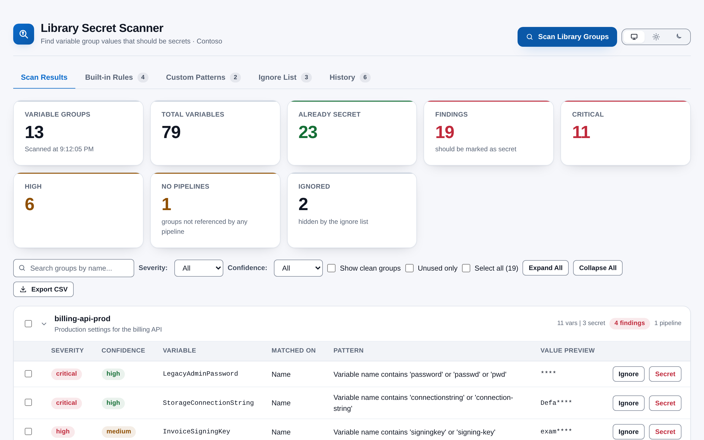
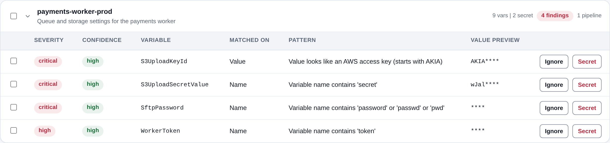

# Library Secret Scanner

Find the passwords, keys and tokens sitting in plain text in your Azure DevOps Library variable groups, and lock them down in a click. Library Secret Scanner is built for project administrators and security reviewers who need one answer: *which variables hold a secret but are not marked as secret?* It lives under **Pipelines > Secret Scanner** and runs entirely in your browser.

## Features

- **Name and value detection** - 50 built-in patterns check variable names (`password`, `secret`, `apikey`, `token`, `connectionstring`, `privatekey`, `accesskey` and more) and values (connection strings, Azure Storage keys, SAS tokens, JWTs, PEM private keys, AWS, GitHub, npm, Google Cloud, Stripe, HashiCorp Vault, Slack, SendGrid and Twilio credentials, Azure DevOps PATs and more).
- **Severity and confidence** - Every finding is rated Critical, High, Medium or Low, with a confidence level based on how specific the pattern is, how random the value looks and what the variable is called.
- **Fewer false positives** - GUIDs, Azure resource IDs and values of ID-style variables such as `TenantId` or `ClientId` are recognised and left alone.
- **Mark as secret** - Mark a single variable, or many across several groups, as secret straight from the results, after a confirmation.
- **Ignore list with expiry** - Dismiss false positives with an optional reason and expiry date, and restore them whenever you like.
- **Custom patterns** - Add your own name or value patterns with a severity, and test them on a sample before saving.
- **Tune the built-in rules** - Switch any rule off or change its severity, and reset to defaults at any time.
- **Pipeline usage** - See which YAML pipelines use each variable group, and spot groups no pipeline references.
- **Key Vault aware** - Key Vault-linked groups are labelled and never modified.
- **Scan history** - Compare the last 10 scans and see whether findings are going up or down.
- **Masked previews and CSV export** - Findings show only the first four characters of a value of 16 or more characters, and nothing of a shorter one. The CSV export of the filtered findings carries the same masked previews, for audits.
- **Follows your Azure DevOps theme** - Light, dark and high contrast, with a manual light/dark override and WCAG AA contrast.

## How it works

1. Open **Pipelines → Secret Scanner** in any project.
2. Click **Scan Library Groups**. Every variable group in the project is checked against the built-in rules and your custom patterns, and the YAML pipelines are read to see which groups they use.
3. Review the findings, grouped by variable group with the riskiest first. Filter by severity or confidence, or search by group name.
4. Mark real secrets as secret, ignore false positives, or export the list.

## Permissions

- **Variable groups (read)** - Read variable groups and their non-secret values to scan them.
- **Variable groups (manage)** - Mark variables as secret when you ask it to.
- **Build (read)** - List pipelines to find which ones use each variable group.
- **Code (read)** - Read pipeline YAML files from your repositories.
- **Project** - Requested for the current project context.

## Privacy

Everything runs in your browser and talks only to your own Azure DevOps organization. There is no telemetry and nothing is sent to any third party. Variable values are never stored. Your custom patterns, rule changes, ignore list and scan history are kept in the Azure DevOps Extension Data Service for your organization; your theme choice stays in your browser.

## Support

Bug reports and feature requests are welcome through GitHub Issues: <https://github.com/adam-wheater/azure-devops-library-secret-scanner/issues>

## License

Copyright © 2026 Adam Wheater. All rights reserved. This software is provided under a proprietary source-available license: you may read and audit the code and use the published extension, but you may not copy, modify, redistribute or republish it. See the LICENSE file for the full terms. The open source components it bundles keep their own licenses, listed in THIRD-PARTY-NOTICES.txt inside the package.
